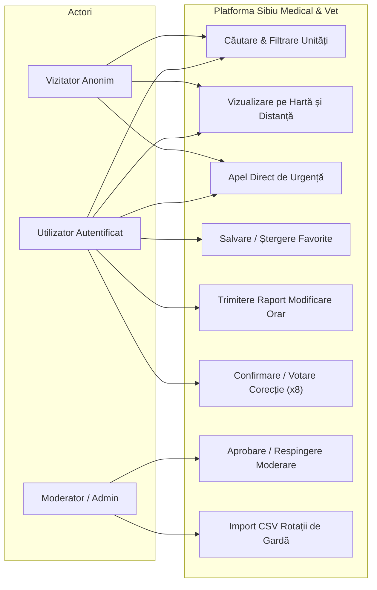
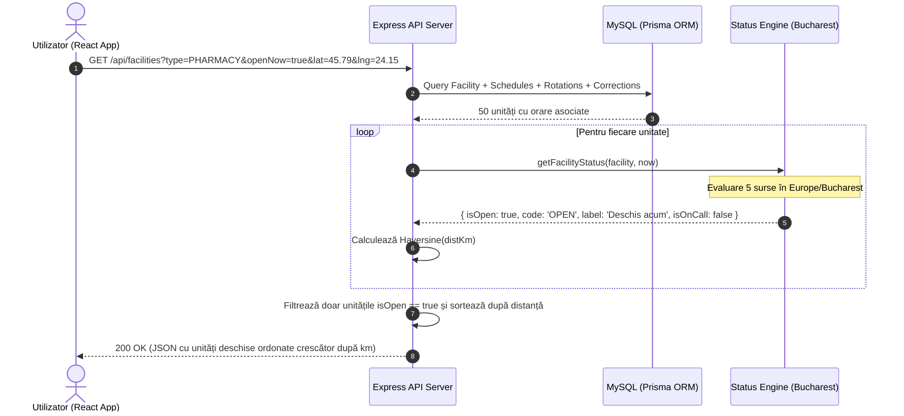
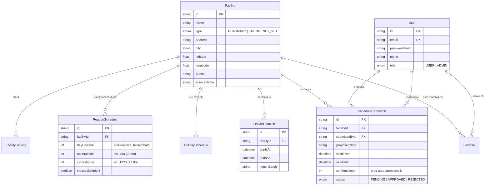

# SPEC.md — Specificația Cerințelor Software (SRS) & Arhitectura Funcțională

> **Proiect P10:** Farmacii de Gardă și Cabinete Veterinare de Urgență în Județul Sibiu  
> **Versiune document:** 1.0 (Etapa Partea C)  
> **Data aprobării:** 17 noiembrie 2026  
> **Standard:** Aliniat la deciziile din [docs/agents/DECISIONS.md](docs/agents/DECISIONS.md) și catalogul de date [DATA.md](DATA.md).

---

## 1. Introducere și Obiective

### 1.1. Scopul Produsului
Aplicația web `proiect-web2` este o platformă critică de informare publică și triaj rapid, destinată cetățenilor, turiștilor și deținătorilor de animale de companie din județul Sibiu. Obiectivul său este de a răspunde instantaneu la întrebarea vitală în caz de urgență nocturnă sau de sărbători legale: **„Unde găsesc acum o farmacie deschisă sau un medic veterinar de gardă disponibil cel mai aproape de mine?”**.

### 1.2. Arealul Geografic și Acoperirea Datelor
Catalogul oficial cuprinde **65 de unități reale** verificate și cartografiate prin coordonate GPS (documentate în `DATA.md` și `sibiu-facilities.json`):
* **50 Farmacii Comunitare (`PHARMACY`):** Municipiul Sibiu (unități Non-Stop, hiper-farmacii de mall, farmacii de cartier cu receptură), Municipiul Mediaș, Orașul Cisnădie, Comuna Șelimbăr, Orașul Avrig, Comuna Cristian, Comuna Șura Mică.
* **15 Unități Veterinare de Urgență (`EMERGENCY_VET`):** Spitale veterinare cu asistență continuă 24/7 (Sibiu), clinici cu linie de gardă de noapte și cabinete cu permanență telefonică / gardă la apel (Sibiu, Șelimbăr, Cisnădie, Mediaș, Avrig).

---

## 2. Domeniul de Aplicare (Scope) și Limite Explicite (Out of Scope)

### 2.1. Funcționalități Incluse în Scope
1. **Catalog și Registru Centralizat:** Căutare rapidă după denumire, stradă, oraș și servicii oferite (ex. rețete compensate CAS, preparate oficinale, chirurgie urgență veterinară).
2. **Motor Deterministic de Calcul al Statusului în Timp Real:** Evaluarea stării de funcționare a fiecărei unități în fusul orar `Europe/Bucharest`, pe baza ierarhiei celor 5 surse de adevăr.
3. **Hartă Interactivă și Triaj Vizual:** Hartă Leaflet cu pini distincți după status (Deschis, Închis, De gardă, Se închide curând) și calculul distanței terestre (Haversine).
4. **Apelare Rapidă de Urgență:** Butoane directe de apel telefonic (`tel:<numar>`) și generare de rute prin link-uri externe Google Maps / Waze.
5. **Crowdsourcing cu Aprobare Comunitară:** Mecanism de raportare a orarelor neprevăzute (inventar, pană de curent), cu auto-aprobare la 8 confirmări ale utilizatorilor (D-001).
6. **Managementul Rotațiilor Lunare de Gardă:** Suport pentru importul graficelor semestriale/lunare în format CSV standardizat.
7. **Ghid de Urgență Local:** Panou cu numere utile și protocoale de triaj pentru județul Sibiu.

### 2.2. Limite Explicite (Strict Out of Scope — D-002)
* **Comerț electronic și plăți:** Nu se acceptă comenzi online de medicamente, adăugare în coș sau procesare de plăți bancare.
* **Telemedicină și chat direct:** Nu există mesagerie instant sau consult medical la distanță; contactul se realizează exclusiv telefonic direct cu unitatea.
* **Stocuri de medicamente în timp real:** Aplicația nu monitorizează inventarul de produse farmaceutice (nu există API-uri publice în România — Q-005).
* **Sistem propriu de navigație turn-by-turn:** Aplicația nu implementează rutare GPS internă, ci redirecționează utilizatorul prin deep links către aplicațiile dedicate de navigație (Google Maps, Waze, Apple Maps — Q-006).

---

## 3. Actori și Matricea Rolurilor / Permisiunilor

Aplicația implementează un model de securitate bazat pe roluri (RBAC), respectând decizia [D-003](docs/agents/DECISIONS.md#D-003):

| Rol utilizator | Căutare & Filtrare | Hartă & Navigație | Apel Telefonic Direct | Salvare Favorite | Raportare Corecție Orar | Vot / Confirmare Corecție | Moderare Sesizări & Corecții | Import CSV Rotații Gardă |
| :--- | :---: | :---: | :---: | :---: | :---: | :---: | :---: | :---: |
| **Vizitator Anonim (Public)** | DA | DA | DA | NU | NU | NU | NU | NU |
| **Utilizator Înregistrat (`USER`)** | DA | DA | DA | DA | DA | DA | NU | NU |
| **Administrator (`ADMIN`)** | DA | DA | DA | DA | DA | DA | DA | DA |

*Notă decizională:* Pentru simplitate arhitecturală (Q-007), permisiunile administrative și de moderare a corecțiilor comunitare sunt unificate în rolul `ADMIN`. Pentru protecția împotriva spam-ului și a vandalismului, doar utilizatorii autentificați pot salva favorite și pot trimite/confirma modificări de orar.

---

## 4. Arhitectura celor 6 Ecrane ale Aplicației

Conform alinierii de produs, interfața web frontend (React 19) este structurată în 6 ecrane/componente principale:

### Ecranul 1: Explorer Principal (Acasă / Descoperire)
* **Bara Superioară de Control:**
  * Selector rapid tip: `Toate` | `Farmacii` | `Urgențe Veterinare`.
  * Filtre rapide (Chips): `Deschis Acum`, `De Gardă / Non-Stop`, `Rețete Compensate`, `Urgențe 24/7`.
  * Dropdown selector de localitate (`Sibiu`, `Mediaș`, `Cisnădie`, `Șelimbăr`, `Avrig`, `Cristian`, `Șura Mică`).
  * Căutare liberă text (denumire sau stradă).
* **Zona de Lucru Responsivă ([PATTERN-001](docs/agents/PATTERNS.md#PATTERN-001)):**
  * **Desktop (>=1024px):** Split-screen cu Harta Leaflet pe jumătate de ecran și lista derulabilă de carduri pe cealaltă jumătate.
  * **Mobil (<1024px):** Comutator fix (sticky toggle) `Hartă` ⟷ `Listă` pentru a asigura acces instant pe ecrane mici.
* **Cardul de Unitate:**
  * Badge de status clar și colorat (`Deschis`, `Închis`, `De gardă`, `Se închide curând în X min`).
  * Distanța calculată (în km) dacă utilizatorul a permis localizarea.
  * Buton mare verde de apel telefonic direct.
  * Buton de salvare rapidă la favorite.

### Ecranul 2: Panou / Modal de Detalii Unitate
* Adresă completă, operator oficial și data ultimei verificări.
* Orarul săptămânal detaliat pe zile (Luni–Duminică), incluzând pauzele de prânz și intervalele de noapte.
* Programul specific de sărbători legale (ex. Sf. Maria, Crăciun, Revelion).
* Lista completă de servicii autorizate (rețetă compensată, vaccinare, imagistică, receptură).
* Butoane de acțiune: `Apelează Unitatea`, `Deschide în Google Maps`, `Adaugă la Favorite`, `Raportează Modificare de Orar`.

### Ecranul 3: Modal / Ecran de Autentificare și Cont
* Formulare comutabile pentru `Autentificare` și `Înregistrare cont nou` (Nume, Email, Parolă).
* Mesaje clare de redirecționare atunci când un vizitator anonim dorește să salveze un favorit sau să raporteze un orar.

### Ecranul 4: Secțiunea „Favoritele Mele”
* Vizualizare dedicată pentru unitățile salvate de utilizator.
* Re-evaluare automată a statusului în timp real la deschidere (esențial pentru a vedea dintr-o privire dacă farmacia sau clinica de proximitate este deschisă noaptea).

### Ecranul 5: Panoul de Moderare și Administrare
* **Pentru Moderatori:** Coadă de revizuire a corecțiilor propuse de utilizatori (`PENDING`), afișând numărul de confirmări acumulate din comunitate și acțiuni de `Aprobă` / `Respinge`.
* **Pentru Administratori:** Modul de import CSV pentru actualizarea graficului lunar de rotații de gardă (`OnCallRotation`), cu previzualizare tabelară a datelor înainte de persistență.

### Ecranul 6: Secțiunea Urgențe & Numere Utile (Județul Sibiu)
* Ghid informativ de triaj pentru urgențe umane și veterinare:
  * Numărul unic de urgență: **112**.
  * Dispecerat DSVSA Sibiu (urgențe sanitar-veterinare): **0269 223 069**.
  * Colegiul Farmaciștilor Sibiu: asistență și rotații oficiale.
  * Contact direct linie roșie Spitalul Veterinar Transilvania (24/7): **0369 991**.

---

## 5. Motorul Deterministic de Calcul al Statusului (Status Engine)

Statusul fiecărei unități este determinat deterministic în fusul orar `Europe/Bucharest`, pe baza ierarhiei stricte a celor **5 surse de adevăr** (implementat în `backend/src/status.js`, verificat de 19 teste automate):

```text
+-------------------------------------------------------------------------+
|                  1. Corecții aprobate de comunitate                     |
|                      (APPROVED_CORRECTION)                              |
|           Suprascriu orice alt orar (ex. Închis pentru inventar)         |
+------------------------------------+------------------------------------+
                                     | (dacă nu există corecție activă)
                                     v
+-------------------------------------------------------------------------+
|                  2. Rotații oficiale de gardă                           |
|                         (ON_CALL_ROTATION)                              |
|         Deschis Non-Stop pe durata gărzii (status ON_DUTY / OPEN)       |
+------------------------------------+------------------------------------+
                                     | (dacă nu este de gardă)
                                     v
+-------------------------------------------------------------------------+
|                  3. Excepții de sărbători legale                        |
|                        (HOLIDAY_SCHEDULE)                               |
|        Suprascriu programul săptămânal standard (Închis sau orar redus) |
+------------------------------------+------------------------------------+
                                     | (dacă nu este zi de sărbătoare)
                                     v
+-------------------------------------------------------------------------+
|                  4. Program săptămânal standard                         |
|                       (REGULAR_SCHEDULE)                                |
|        Intervale pe zile (0=Dum .. 6=Sâm), pauze de masă, ture de noapte|
+------------------------------------+------------------------------------+
                                     | (dacă este deschis)
                                     v
+-------------------------------------------------------------------------+
|                  5. Avertizare închidere iminentă                       |
|                          (CLOSING_SOON)                                 |
|            Dacă unitatea se închide în mai puțin de 30 de minute        |
+-------------------------------------------------------------------------+
```

---

## 6. Diagrame Arhitecturale (Mermaid)

### 6.1. Diagrama Cazurilor de Utilizare (Use Case Diagram)



### 6.2. Diagrama de Secvență: Calculul Statusului și Căutarea



### 6.3. Diagrama Entitate-Relație (ERD)



---

## 7. Cerințe Non-Funcționale

1. **Fus Orar, Integritate Temporală și Politică de Reîmprospătare:**
   * Toate evaluările de orar se efectuează obligatoriu în fusul orar oficial `Europe/Bucharest` (evitând discrepanțele cauzate de serverele în UTC sau clienți din alte fusuri orare).
   * Motorul gestionează corect tranzițiile orei de vară/iarnă (Daylight Saving Time).
   * **Re-evaluare locală la 60 de secunde:** Interfața client rulează un timer local la fiecare 60s care recalculează starea unităților în fusul `Europe/Bucharest` pentru a asigura tranziții prompte și exacte către `CLOSING_SOON` și `CLOSED` fără a necesita reîncărcarea paginii.
   * **Reîmprospătare din API la 5 minute:** Clientul efectuează un `refetch` periodic către `GET /api/facilities` la fiecare 5 minute pentru a prelua eventuale modificări de server, rotații noi sau corecții aprobate.
2. **Performanță și Timp de Răspuns:**
   * Endpoint-ul principal de căutare `GET /api/facilities` răspunde în sub **150ms** pentru cele 65 de unități.
   * Suport pentru căutare și redare fluidă a hărții fără blocarea firului de execuție în browser.
3. **Securitate și Autentificare:**
   * Parolele utilizatorilor sunt stocate securizat folosind algoritmul `bcrypt` (cost factor 10).
   * Sesiunile sunt gestionate prin token-uri `JWT` semnate, cu expirare la 7 zile.
4. **Accesibilitate și Utilizare în Urgență:**
   * Interfață adaptată pentru utilizare pe timp de noapte (contrast înalt, vizibilitate crescută a butoanelor de apel telefonic).
   * Butoanele de apel direct au o zonă de atingere (touch target) de minimum 48x48px conform standardelor mobile.
